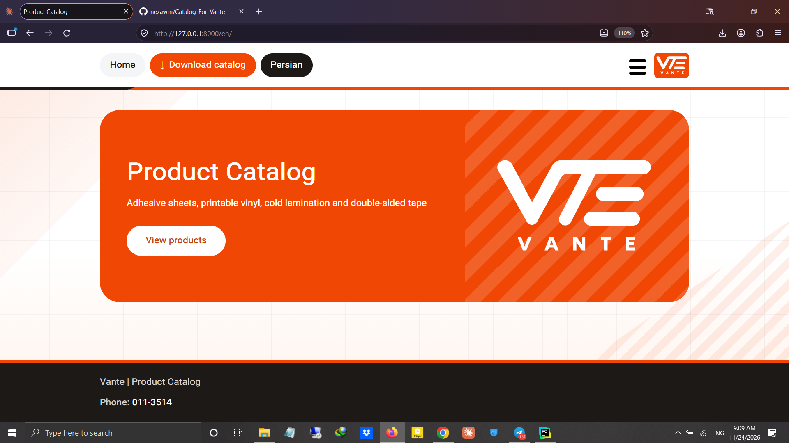
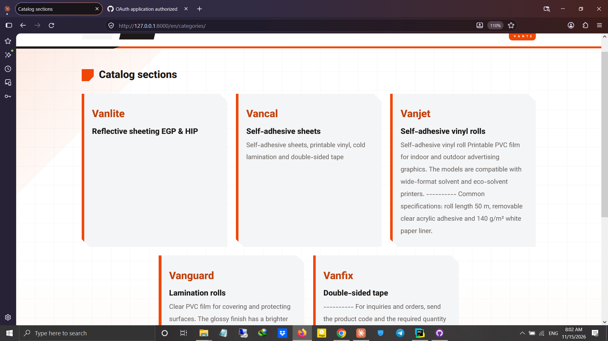

# VanteCTL

A bilingual (Persian / English) product catalog built with Django, featuring a dedicated Persian-language management panel for non-technical clients.


<!-- Replace with a real screenshot after uploading it to docs/screenshots/ -->
<!--  -->

## Table of Contents

- [Features](#features)
- [Screenshots](#screenshots)
- [Tech Stack](#tech-stack)
- [Project Structure](#project-structure)
- [Getting Started](#getting-started)
- [Configuration](#configuration)
- [Client Panel](#client-panel)
- [Running Tests](#running-tests)
- [Deployment](#deployment)
- [License](#license)

## Features

- **Hierarchical catalog**: categories, subcategories, and products with configurable display order.
- **Bilingual content**: every title, name, and description has a Persian and an English version; visitors choose their language on the landing page.
- **Client management panel** at `/panel/`: a simple, always-Persian interface for creating, editing, and deleting categories, subcategories, and products, with no need to use the Django admin.
- **Automatic slugs**: URL-friendly slugs are generated from names, with a live preview in the panel and admin.
- **Role-based access**: a dedicated `Catalog Manager` group limits panel users to catalog permissions only. It is created automatically after `migrate`.
- **Configuration via environment variables**: secrets and deployment settings are kept out of the source code.

## Screenshots

Add screenshots to `docs/screenshots/` and reference them here:

| Home | Product detail | Client panel |
| --- | --- | --- |
|  |  |  |

## Tech Stack

| Layer | Technology |
| --- | --- |
| Language | Python 3.13 |
| Framework | Django 6.1 |
| Database | SQLite (default) |
| Configuration | python-dotenv |
| Front end | Django templates, vanilla CSS and JavaScript |

## Project Structure

```
VanteCTL/
├── VanteCTL/      # Project settings, root URLs, WSGI/ASGI
├── Core/          # Landing page, language selection, shared helpers
├── Category/      # Category and Subcategory models and public views
├── Product/       # Product model and public views
├── Panel/         # Client management panel (views, forms, middleware)
├── templates/     # HTML templates, grouped by app
├── static/        # CSS, JavaScript, and images
├── .env.example   # Template for environment variables
└── requirements.txt
```

## Getting Started

### Prerequisites

- Python 3.13 or newer
- Git

### Installation

```bash
# 1. Clone the repository
git clone https://github.com/<your-username>/VanteCTL.git
cd VanteCTL

# 2. Create and activate a virtual environment
python -m venv .venv
source .venv/bin/activate        # Windows: .venv\Scripts\activate

# 3. Install dependencies
pip install -r requirements.txt

# 4. Create your environment file and edit the values
cp .env.example .env             # Windows: copy .env.example .env

# 5. Create the database and an admin user
python manage.py migrate
python manage.py createsuperuser

# 6. Start the development server
python manage.py runserver
```

Open <http://127.0.0.1:8000/> in your browser. The Django admin is available at `/admin/`.

## Configuration

All settings are read from a `.env` file in the project root. Copy `.env.example` to `.env` and adjust it.

| Variable | Description | Default |
| --- | --- | --- |
| `DJANGO_SECRET_KEY` | Secret key used for signing. **Always set a unique value.** | insecure placeholder |
| `DJANGO_DEBUG` | Enables debug mode (`True` / `False`). | `True` |
| `DJANGO_ALLOWED_HOSTS` | Comma-separated list of allowed hostnames. | `localhost,127.0.0.1` |
| `DJANGO_CSRF_TRUSTED_ORIGINS` | Comma-separated trusted origins, e.g. `https://example.com`. | empty |
| `DJANGO_DB_NAME` | SQLite database file name. | `db.sqlite3` |
| `DJANGO_EMAIL_BACKEND` | Django email backend class. | console backend |

To generate a secret key:

```bash
python -c "import secrets; print(secrets.token_urlsafe(50))"
```

## Client Panel

The panel at `/panel/` is intended for the site owner or client. It is always shown in Persian, regardless of the site language.

Create a panel user from the command line:

```bash
python manage.py create_panel_client <username>
```

You will be prompted for a password. Alternatively, create a user in the Django admin and add them to the **Catalog Manager** group.

Panel users can view, add, change, and delete categories, subcategories, and products, and nothing else.

## Running Tests

```bash
python manage.py test
```

## Deployment

Before deploying to production:

1. Set `DJANGO_DEBUG=False` and a unique, random `DJANGO_SECRET_KEY`.
2. Set `DJANGO_ALLOWED_HOSTS` and `DJANGO_CSRF_TRUSTED_ORIGINS` to your domain.
3. Collect static files with `python manage.py collectstatic`. They are written to `staticfiles/`.
4. Serve the application with a production WSGI/ASGI server (for example Gunicorn behind Nginx) and serve static files from `staticfiles/`.
5. Back up `db.sqlite3` regularly, or move to a production database such as PostgreSQL.

> `.env` and `db.sqlite3` are intentionally excluded from version control. Never commit secrets or user data.

## License

No license has been specified yet. Add a `LICENSE` file to define how others may use this project.
